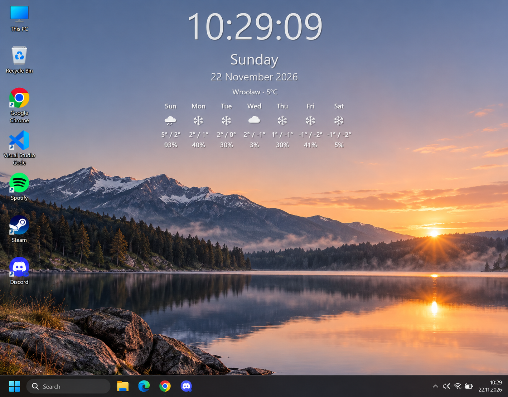

# Desktop Clock & Weather - a Windhawk mod

Shows time, weekday, date and a 3-7 day weather forecast directly on the Windows desktop,
**above the wallpaper but below icons and folders**, so it is never clickable.

Weather comes from [Open-Meteo](https://open-meteo.com) (free, no API key).

## Features
- Position (9 anchor points + margins), monitor choice, overall widget size (%)
- Font family, size and color for each element, bold/italic, text shadow, optional background panel
- Order of elements (e.g. weather on top, time in the middle)
- City selection, Celsius/Fahrenheit, 3-7 forecast days, row or column layout, precipitation chance
- Date format and language, 12/24-hour clock, seconds

## Why this is a separate mod
Desktop Live Overlay is a flexible desktop overlay with configurable text patterns and system metrics.
Desktop Clock & Weather focuses on a structured multi-day forecast: a 3-7 day grid with weather icons,
high/low temperatures and precipitation probability, plus independently configurable time, weekday,
date and weather presentation. It uses Open-Meteo for forecast data. This narrower forecast-oriented
layout is the reason for keeping it as a separate mod rather than duplicating a general-purpose overlay.

## Install
1. Install [Windhawk](https://windhawk.net).
2. In Windhawk click **Create a new mod**, paste the contents of `mods/desktop-clock-weather.wh.cpp`, then **Compile**.
3. Open the mod's **Settings** tab to customize.

## Network use
Weather is the only feature that uses the network, and only after you enter a city in the settings and
keep **Show weather** enabled with `weather` included in the element order. The mod sends HTTPS requests
to two Open-Meteo hosts:

- `geocoding-api.open-meteo.com` - when the city or language changes, to turn the city name into coordinates.
  The city name and a two-letter language code are sent.
- `api.open-meteo.com` - at startup and then every N minutes (30 by default), to get the current temperature
  and forecast. The coordinates and selected temperature unit are sent.

After a failed request, the mod retries after about 60 seconds. Like any web server, Open-Meteo can see
your IP address with each request. No API key, account or other personal data is sent. No weather requests
are made while the city setting is empty, **Show weather** is off, or `weather` is omitted from the element order.

## License
MIT - see [LICENSE](LICENSE).
